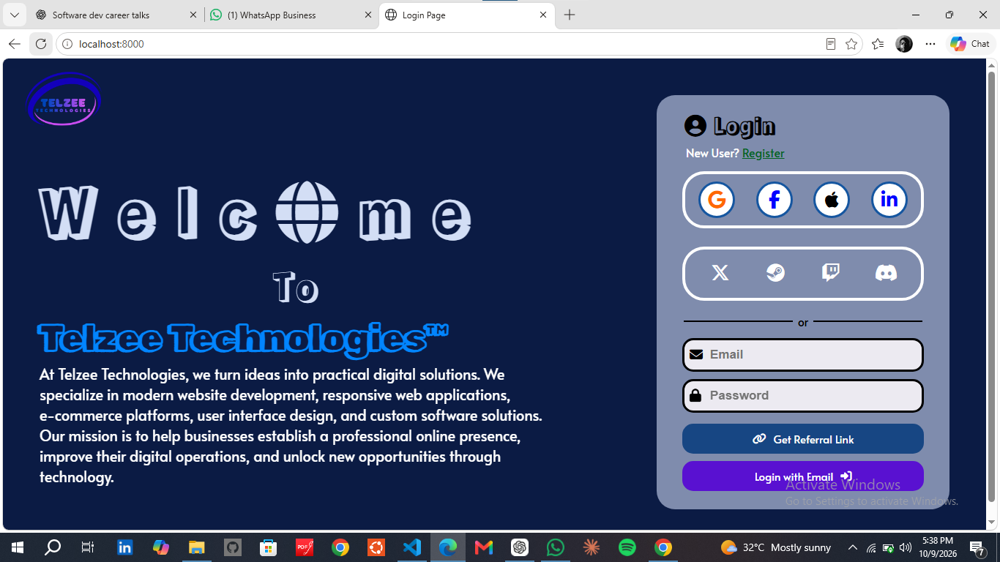
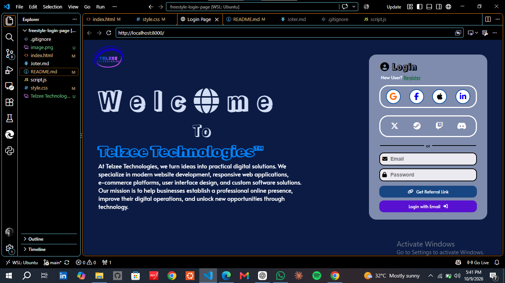

# Freestyle Login Page

A custom-designed, two-column login interface built with HTML and CSS, featuring Telzee Technologies branding, animated typography, social authentication UI elements, and a structured email login form.

The project explores modern interface design, CSS layout techniques, visual hierarchy, and interactive styling through a fully customized authentication page.

## Preview


*Desktop preview of the interface.*

> Update the image path above to match the screenshot filename in the repository.

## Features

- **Custom two-column layout** — separates company branding and introductory content from the login interface.
- **Branded introduction** — features the Telzee Technologies logo, animated welcome heading, and company description.
- **Social login interface** — circular buttons featuring Google, Facebook, Apple, and X, alongside additional platform icons.
- **Email login form** — email and password inputs with icons, placeholders, and focus states.
- **Action buttons** — dedicated Login with Email and Get Referral Link controls.
- **CSS animations** — staggered text reveals and icon entrance effects.
- **Interactive styling** — hover transitions, rounded components, and custom colors.
- **Accessible form labels** — associated labels for email and password inputs, visually hidden to preserve the interface layout.

## Technologies Used

| Technology   | Purpose                                                      |
| ------------ | ------------------------------------------------------------ |
| HTML5        | Semantic structure and form elements                         |
| CSS3         | Layout, styling, Flexbox, animations, and interactive states |
| JavaScript   | Included as a separate project script                        |
| Font Awesome | Icons and platform symbols                                   |
| Google Fonts | Custom typography                                            |

## Project Structure

```text
freestyle-login-page/
├── index.html
├── style.css
├── script.js
├── README.md
├── .gitignore
└── Telzee Technologies Orbit Logo.png
```

Additional screenshots and development notes may be included in the repository.

## Getting Started

1. Clone the repository:

   ```bash
   git clone git@github.com:telzee001/freestyle-login-page.git
   ```

2. Navigate into the project directory:

   ```bash
   cd freestyle-login-page
   ```

3. Open `index.html` in a modern web browser, or serve the project using a local development server.

An internet connection is required to load Google Fonts and Font Awesome from their respective CDNs.

## Implementation Highlights

### Layout and Component Styling

The interface uses CSS Flexbox to arrange the introduction and login card, align authentication icons, and organize form controls.

### Animated Typography

Individual letters and words use CSS custom properties and animation delays to produce sequential entrance effects.

### Form Design

The email and password fields include positioned icons, associated labels, and custom focus styling. The form's controls are grouped within a dedicated authentication panel.

### Branding

The design incorporates a custom Telzee Technologies logo, a navy-blue background, contrasting interface colors, and decorative display typography.

## Current Scope

This project demonstrates the front-end interface of a login page. Authentication providers, account registration, referral generation, and backend user management are not implemented as part of the demonstrated UI.

The interface has been developed and reviewed primarily in a desktop browser. Full responsive optimization remains a potential improvement.

## Author

**Telzee001**

GitHub: [github.com/telzee001](https://github.com/telzee001)

---

Built with HTML, CSS, and a focus on custom interface design.



